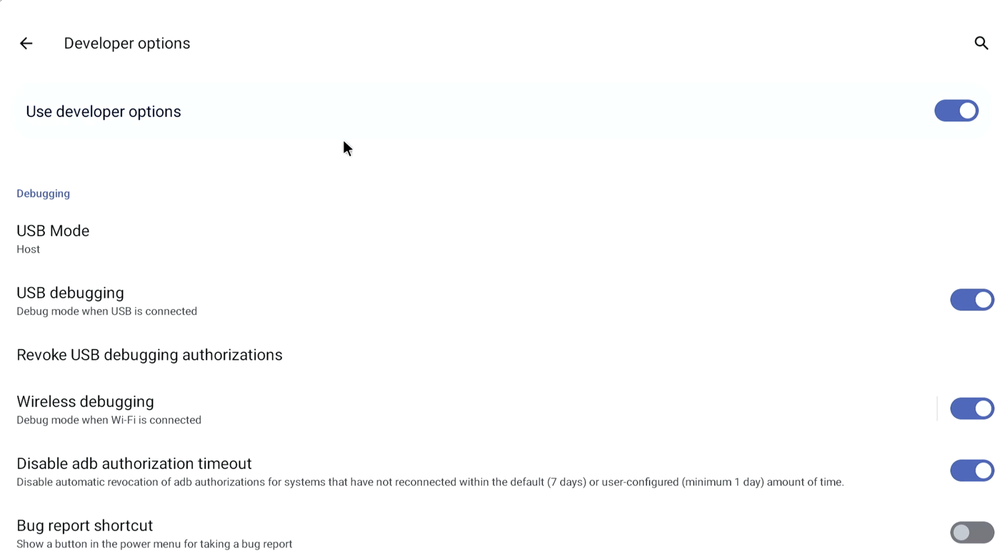
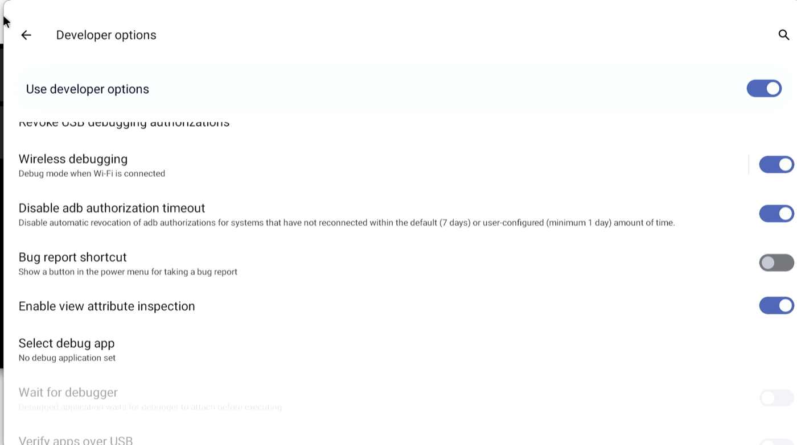
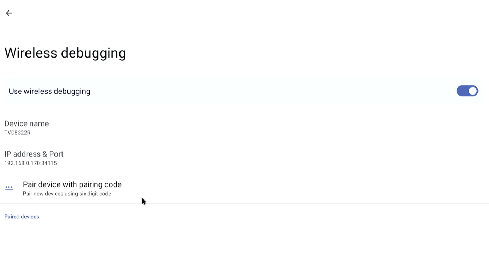

# LincStation E1 → Debian 13 + OpenMediaVault

Replace the stock Android/LincOS firmware on a **LincStation E1** NAS (Rockchip RK3568, 4 GB RAM, 64 GB eMMC) with plain **Debian 13 ARM64** and **OpenMediaVault 8**. You can keep it headless or add a lightweight LXDE desktop, a choice of app groups, and VNC.

**[Read the full step-by-step installation guide](docs/INSTALL.md)** · [What you need](#what-you-need) · [Turning on ADB](#before-you-start-turn-on-adb-on-the-nas) · [Quick start](#quick-start) · [What was tested](docs/VALIDATION.md)

> **Status: experimental.** The process below worked on one E1. The reusable installer in `installer/` has passed build and unit tests, but nobody has run it end to end on a second stock E1 yet. Read [docs/INSTALL.md](docs/INSTALL.md) completely before touching your NAS, and keep your backups.

## How I did it

1. **Enabled developer mode and connected through ADB.**
   This gave me an Android shell with limited permissions.

2. **Used the bundled download service to gain root.**
   The ADB shell could read the authentication secret for aria2, a download service inside the NAS's Linux environment. I used its authenticated API to download a small scheduled-task file into a privileged directory. The scheduler then ran that task as root.

3. **Established root SSH access and backed up the device.**
   That task started a temporary, key-only SSH server. I could then inspect the hardware and make verified backups of the original firmware and eMMC.

4. **Built Linux images that the existing bootloader understood.**
   The bootloader was already unlocked, so I didn't need to defeat signature verification. I packaged Debian's ARM64 kernel and drivers into Android-style boot images, with a device tree describing the E1's hardware.

5. **Tested Linux in RAM before installing it.**
   I initially preserved Android in the other boot slot. The main obstacle was restarting reliably: a device-tree change made Linux use the firmware's restart mechanism instead of the problematic PMIC restart handler.

6. **Installed Debian and kept a recovery boot slot.**
   Once those tests passed, I replaced the eMMC userdata filesystem with Debian, configured the custom startup process, and added OMV, LXDE, apps and VNC.

The key ingredients were the aria2-to-root opening, an already-unlocked bootloader, and getting the board-specific Linux boot details right.

## What works

| Feature | Status |
| --- | --- |
| Debian 13, official `6.12` ARM64 kernel | Working; boots from eMMC |
| Normal reboot | Working after the device-tree restart fix |
| 2.5 GbE Ethernet (RTL8125B) | Working at 2.5 Gbps, factory MAC restored |
| Both SATA bays | Working with 6 Gbps links |
| Power-off and power-button start | Working; shuts down cleanly and starts again from the front button |
| Automatic desktop login | Optional, like a Raspberry Pi; `sudo lincstation-autologin on USER` |
| Power monitoring | Not available. The board has no power or current sensor, so measure total draw with a plug-in power meter |
| Fan control | Working, with `quiet`, `balanced` (default) and `performance` profiles plus a custom curve. Switch with `sudo lincstation-fan performance`; see [Fan curve](docs/INSTALL.md#fan-curve) |
| OpenMediaVault 8 web UI | Working |
| HDMI desktop (LXDE), Mali-G52 GPU rendering | Working at 1080p60 with Panfrost/Mesa |
| VNC (over an SSH tunnel) | Working |
| Kernel updates through `apt` | Working; a hook rebuilds the boot image |
| RAM recovery boot slot with SSH | Working |
| Power-off | Not yet validated |
| CPU performance | Geekbench 6: 230 single-core, 605 multi-core. Full result: [browser.geekbench.com/v6/cpu/19377989](https://browser.geekbench.com/v6/cpu/19377989) |
| Hardware video decoding | H.264 and MPEG-2 up to 1080p, VP8 up to 4K, through GStreamer players such as Parole, after a one-line install the installer shows you (see [VALIDATION](docs/VALIDATION.md#hardware-video-decoding)). VLC and mpv decode on the CPU. |
| HEVC/H.265, VP9, 4K H.264 | No hardware decoder with this kernel; CPU only |
| Wi-Fi (RTL8822CS, 2.4 and 5 GHz) | Working; scans both bands. Joining a network not yet tested. The SDIO link runs at 50 MHz high speed, not SDR104 |
| Bluetooth (RTL8822CS) | Working; controller up and scanning. Pairing not yet tested |
| NVMe slots | Not tested (empty on the test unit) |

## What you need

- A LincStation E1 running its stock firmware, with physical access to its power cable
- A wired LAN, and a static IP address reserved for the NAS in your router
- A **helper computer** on the same network, with about 80 GB free for the full eMMC backup

The helper does the backup, builds the Debian images and drives every step over the network. Any of these will work:

| Helper | How the build runs | Tested |
| --- | --- | --- |
| Debian 13 on ARM64 (e.g. Raspberry Pi) | Natively | Yes, the original migration used a Pi |
| Debian 13 on x86-64 | Through QEMU ARM64 emulation; slower | Not yet |
| macOS on Apple Silicon | In a temporary Debian ARM64 container | Not yet |
| macOS on Intel | In a temporary Debian container under Docker's ARM64 emulation; slowest | Build tested (about 50 minutes); not yet used for a real install |

On Debian, install `adb`, `openssh-client` and `python3`. On a Mac, install `adb` with `brew install android-platform-tools`, plus Docker Desktop, OrbStack or Colima.

## Before you start: turn on ADB on the NAS

The installer gets in through Android's debugging connection (ADB) over the network, and you have to switch it on at the NAS itself. You'll need an HDMI monitor and a USB keyboard (a mouse helps) plugged into the NAS.

1. **Open Android Settings.** The NAS boots into the LincOS kiosk screen. Press **Ctrl+N** on the keyboard to open Settings.
2. **Connect the NAS to Wi-Fi**, even if you'll use the wired connection. Android won't turn on wireless debugging without a Wi-Fi network. The installer itself still uses the wired IP.
3. **Open Developer options** (*Settings → System → Developer options*) and make sure *Use developer options* is on. It was already on on the tested unit. If Developer options isn't listed, open *About device* and tap *Build number* seven times.

   

4. **Turn on Wireless debugging, then open it.** Flip the switch, then **click the words "Wireless debugging" to the left of the switch**. The switch only turns it on; clicking the label opens its settings screen.

   

5. **Pair the helper.** The Wireless debugging screen shows the NAS's *IP address & Port*. The port is random, not 5555. Choose *Pair device with pairing code*, then on the helper run:

   ```sh
   adb pair NAS_IP:PAIRING_PORT          # enter the six-digit code shown on the NAS
   adb connect NAS_IP:PORT               # the "IP address & Port" from this screen
   adb tcpip 5555                        # switch ADB to the fixed port the installer uses
   adb connect NAS_IP:5555
   ```

   

6. **Allow ADB through the LincOS firewall.** Add a rule allowing **TCP port 5555** from your LAN, for example `192.168.1.0/24`. If pairing or the first connect is refused, the firewall may also be blocking the random ports shown on the Wireless debugging screen.
7. **Accept the prompt.** When the helper connects, an **"Allow debugging?"** prompt appears on the NAS screen. Tick *Always allow from this computer* and accept. `adb devices` should list the NAS as `device`, not `unauthorized`.

Network ADB switches off again whenever Android restarts. If `adb connect NAS_IP:5555` fails after a reboot, repeat steps 4 and 5 (pairing is remembered, so `adb connect` to the shown port, then `adb tcpip 5555`, is usually enough).

## Quick start

```sh
git clone https://github.com/bourbonicfisky/lincstation-e1-debian.git
cd lincstation-e1-debian/installer
WORK="$HOME/e1-private"          # private state; never commit or share this
python3 e1-migrate.py --work "$WORK" init \
  --nas 192.168.1.50/24 --gateway 192.168.1.1 \
  --timezone America/Los_Angeles --user nas
python3 e1-migrate.py --work "$WORK" root
python3 e1-migrate.py --work "$WORK" backup
python3 e1-migrate.py --work "$WORK" build
```

`init` asks what to install on top of OpenMediaVault:

```
OpenMediaVault is always installed. Choose the extras:
  [x] 1  Desktop (LXDE on HDMI, started with startx)
  [x] 2    Web browser (Firefox ESR)
  [x] 3    Media players (VLC, mpv, FFmpeg, ALSA tools)
  [x] 4    Utilities (text editor, image viewer, archives, calculator, screenshots, htop)
  [x] 5    Remote desktop (VNC through an SSH tunnel)
  [ ] 6    Log in to the desktop automatically at boot, like a Raspberry Pi
Numbers to toggle (e.g. "3 5"), or Enter to accept:
```

Turn off item 1 for a headless NAS. Item 6 boots straight into the desktop on the HDMI screen, like Raspberry Pi OS. That's handy during setup, and it means VNC works without anyone logging in at the console. You can also skip the checklist with flags: `--no-desktop`, `--apps web,media` (or `all` / `none`), `--no-vnc` and `--autologin`. To change your mind later, pass the same flags to the final `finish` step.

Every step that writes to the NAS needs an explicit `--write`, and the steps pause at each reboot so you can check them. After each reboot, the installer waits for the NAS and tells you which system came back. If the NAS hangs, it tells you when to unplug and replug the power cable. The full procedure, including the recovery tests you must pass before erasing anything, is in **[docs/INSTALL.md](docs/INSTALL.md)**.

## On the NAS after installing

The installer leaves a guide on the NAS itself, covering everyday use, fan profiles, Wi-Fi and Bluetooth, video playback, updates and what to do if something goes wrong. It has the NAS's own address and user name filled in. Open it with `lincstation-help`, find it at `~/LINCSTATION-README.md`, or use the **LincStation Guide** desktop icon. The login message points to it too.

## Using an AI coding agent

I worked out this migration with AI coding agents, and the repository contains everything an agent needs to run the installer for you: the staged CLI, the full guide in [docs/INSTALL.md](docs/INSTALL.md), and agent-specific rules in [AGENTS.md](AGENTS.md). Open the repository in an agent such as Claude Code or Codex on your helper computer and ask it to follow AGENTS.md.

Some steps still need you. The agent should stop and ask you to turn on ADB at the NAS screen, to power-cycle the NAS if it hangs, to pick your software extras, and to confirm before anything is erased. Don't let an agent bypass the installer's safety checks.

## Safety notes

- **Back up first.** The `backup` step saves the whole eMMC. Keep that image somewhere safe.
- The installer **erases only the eMMC's Android userdata partition**. It never touches the bootloader, the partition table or your SATA drives.
- It refuses to run on firmware or partition layouts that don't match the tested unit. Don't remove those guards.
- If a reboot hangs, **unplug the power cable for 10 seconds**. The front button doesn't fully cut power.
- Your private work directory holds SSH keys, passwords and device-specific images. **Never commit or share it.**

## Repository layout

```
installer/        the migration toolkit (run on the helper machine)
  e1-migrate.py     staged migration CLI: init → root → backup → build → test → install → finish
  root-stock.py     root access through the stock aria2 service
  build.py          builds the recovery and installed boot images plus the Debian root
  device.py         guarded on-device checks and writes
  finish*.py        installs OMV and the chosen extras on the new system
  install-desktop.sh, configure-desktop.py   LXDE desktop and app groups
  setup-vnc.py, connect-vnc.sh              tunneled VNC
  templates/        early-boot init scripts, boot-success service, kernel update hook
  assets/           E1 device tree, tested DTB, AOSP mkbootimg, Rockchip resource tool
  tests/            non-device guard tests
docs/
  INSTALL.md        full step-by-step guide
  VALIDATION.md     what was measured and what wasn't
  images/           screenshots for the README
```

Documentation:

- **[docs/INSTALL.md](docs/INSTALL.md)**: the full step-by-step installation guide
- [docs/VALIDATION.md](docs/VALIDATION.md): what was measured on real hardware, and what wasn't
- [AGENTS.md](AGENTS.md): instructions for AI coding agents running the installer

Run the tests with `cd installer && python3 -m unittest discover -s tests -v`.

## License

The migration scripts are MIT licensed ([LICENSE](LICENSE)). The bundled AOSP tools are Apache-2.0, and the Rockchip resource tool and Linux device-tree sources are GPL-2.0. See [THIRD-PARTY.md](THIRD-PARTY.md).

This project isn't affiliated with LincPlus or Techvision. It comes with no warranty: you can brick your NAS, so use it at your own risk.
